<a href="https://anamcode.space">
  <picture>
    <source media="(prefers-color-scheme: dark)" srcset="assets/banner-dark.svg">
    
  </picture>
</a>

  <a href="https://anamcode.space"><picture><source media="(prefers-color-scheme: dark)" srcset="assets/badges/portfolio-dark.svg"></picture></a>
  <a href="https://anamcode.space/Khoirul-Anam-CV.pdf"><picture><source media="(prefers-color-scheme: dark)" srcset="assets/badges/cv-dark.svg"></picture></a>
  <a href="https://www.linkedin.com/in/khoirulanam1604"><picture><source media="(prefers-color-scheme: dark)" srcset="assets/badges/linkedin-dark.svg"></picture></a>
  <a href="mailto:khoirulanam1604@mail.ugm.ac.id"><picture><source media="(prefers-color-scheme: dark)" srcset="assets/badges/email-dark.svg"></picture></a>
  <a href="https://medium.com/@khoirulanam1604"><picture><source media="(prefers-color-scheme: dark)" srcset="assets/badges/medium-dark.svg"></picture></a>
  <a href="https://play.google.com/store/apps/dev?id=5031546454633119163"><picture><source media="(prefers-color-scheme: dark)" srcset="assets/badges/googleplay-dark.svg"></picture></a>

## About

I build mobile apps for Android and iOS with Flutter and Kotlin, plus web frontends for internal systems. I like taking a product from the first screen design all the way to a release on Google Play and the App Store.

- **Now:** Software Developer in the Digitalization Unit of the IT Department at PT Petrokimia Gresik. I continue AgrooFertile, develop DILOC for mobile and web, and work on the web frontend of Digilabs, the company's laboratory service platform.
- **Shipped:** 5 apps on Google Play and 2 on the App Store, and I handle their releases.
- **Studied:** Computer Science at Universitas Gadjah Mada, graduated October 2026 with a GPA of 3.98 (Cum Laude). My thesis compared MobileNetV2 with a generative AI model using selective few-shot learning for waste classification.

## Tech stack

<picture>
  <source media="(prefers-color-scheme: dark)" srcset="assets/stack-dark.svg">
  
</picture>

## Featured projects

<table>
  <tr>
    <td width="50%" valign="top">
      <a href="https://play.google.com/store/apps/details?id=com.petrokimia.agrifertile">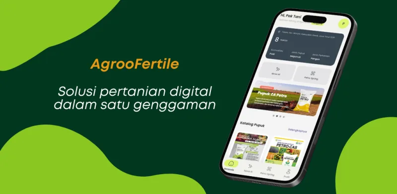</a>
      <h3>AgrooFertile</h3>
      
Agronomy services app by PT Petrokimia Gresik for farmers, field agronomists, drone pilots, and internal teams. Started during my internship and still in active development.

      
<code>Flutter</code> <code>Dart</code> <code>Android</code> <code>iOS</code>

      
<a href="https://play.google.com/store/apps/details?id=com.petrokimia.agrifertile">Google Play</a> | <a href="https://apps.apple.com/id/app/agroofertile/id6762578720">App Store</a>

    </td>
    <td width="50%" valign="top">
      <a href="https://play.google.com/store/apps/details?id=com.pkg.diloc">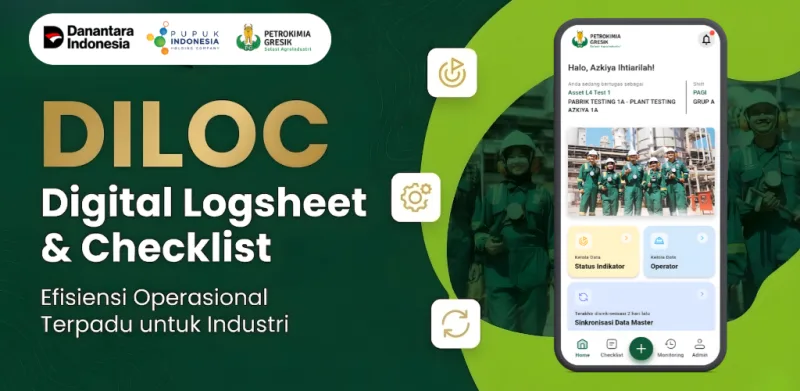</a>
      <h3>DILOC</h3>
      
Digital Logsheet &amp; Checklist by PT Petrokimia Gresik, for phones, tablets, and the web. One Flutter codebase for Android and iOS.

      
<code>Flutter</code> <code>Dart</code> <code>Android</code> <code>iOS</code> <code>Web</code>

      
<a href="https://play.google.com/store/apps/details?id=com.pkg.diloc">Google Play</a> | <a href="https://apps.apple.com/id/app/diloc/id6763480518">App Store</a>

    </td>
  </tr>
  <tr>
    <td width="50%" valign="top">
      <a href="https://etd.repository.ugm.ac.id/penelitian/detail/286836">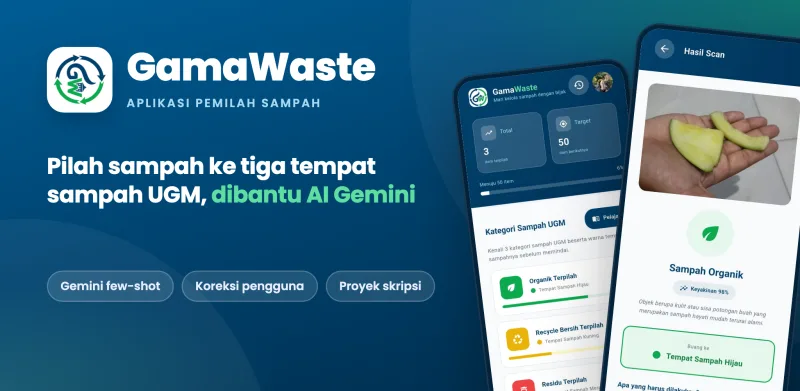</a>
      <h3>GamaWaste</h3>
      
Thesis app that sorts waste into the three UGM bin categories with Gemini through Cloud Functions. The mode (zero-shot, few-shot, or selective re-inference) is set from Firestore without a new build. Selective few-shot reached 94.4% accuracy, against 77.8% for MobileNetV2.

      
<code>Flutter</code> <code>Cloud Functions</code> <code>Firestore</code> <code>Gemini</code>

      
<a href="https://etd.repository.ugm.ac.id/penelitian/detail/286836">Thesis at ETD UGM</a> | <a href="https://github.com/khrlanamm/gamaresik">Repository</a>

    </td>
    <td width="50%" valign="top">
      <a href="https://play.google.com/store/apps/details?id=com.kuartet.mbois">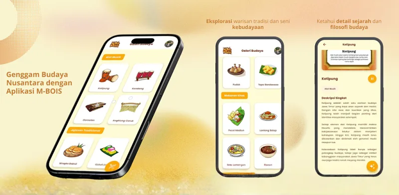</a>
      <h3>M-BOIS</h3>
      
Companion Android app for an East Javanese culture card game. Scanning a card opens its 3D object in AR, audio narration, and a Gemini assistant. Built solo. Top 50 of the student category at BudayaGO! 2025.

      
<code>Kotlin</code> <code>Jetpack Compose</code> <code>Firebase</code> <code>ML Kit</code> <code>Gemini</code>

      
<a href="https://play.google.com/store/apps/details?id=com.kuartet.mbois">Google Play</a> | <a href="https://github.com/khrlanamm/M-BOIS">Repository</a>

    </td>
  </tr>
  <tr>
    <td width="50%" valign="top">
      <a href="https://kopken-insights.web.app">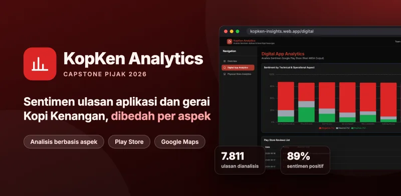</a>
      <h3>KopKen Analytics Dashboard</h3>
      
Aspect-based sentiment analysis of 7,811 Kopi Kenangan app and store reviews, shown in an interactive dashboard. Capstone for Pijak in collaboration with IBM SkillsBuild, score 94.

      
<code>Python</code> <code>SVM</code> <code>TF-IDF</code> <code>Next.js</code> <code>Recharts</code>

      
<a href="https://kopken-insights.web.app">Live dashboard</a> | <a href="https://github.com/khrlanamm/kopken-analytics-dashboard">Repository</a>

    </td>
    <td width="50%" valign="top">
      <a href="https://play.google.com/store/apps/details?id=com.khrlanamm.mandu">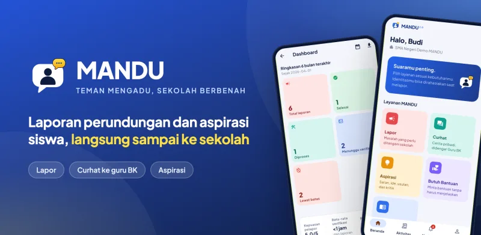</a>
      <h3>Mandu (Teman Ngadu)</h3>
      
Bullying report app for SMA Negeri 1 Sukodadi, published by Komunitas Kertas Kosong. Students report incidents and send aspirations, and the school follows up from a dashboard. Rewritten from Kotlin to Flutter for version 4.

      
<code>Flutter</code> <code>Kotlin</code> <code>Firebase</code>

      
<a href="https://play.google.com/store/apps/details?id=com.khrlanamm.mandu">Google Play</a> | <a href="https://github.com/khrlanamm/mandu">Repository</a>

    </td>
  </tr>
</table>

<b>More projects</b>

 

<table>
  <tr>
    <td width="34%"><a href="https://play.google.com/store/apps/details?id=com.khrlanamm.jelajahsungaipulai">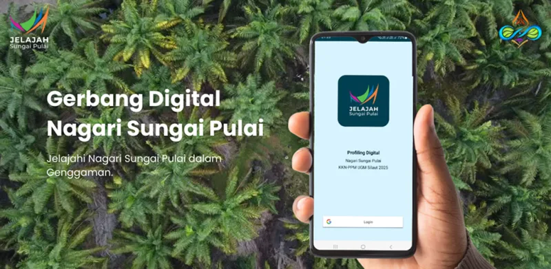</a></td>
    <td valign="top"><b>Jelajah Sungai Pulai</b> Village profile app for Nagari Sungai Pulai, West Sumatra. Built during KKN-PPM UGM 2025, tested by 20 residents over 14 days, and handed over to the village. <code>Kotlin</code> <code>Firebase</code> <a href="https://play.google.com/store/apps/details?id=com.khrlanamm.jelajahsungaipulai">Google Play</a> | <a href="https://github.com/khrlanamm/JelajahSungaiPulai">Repository</a></td>
  </tr>
  <tr>
    <td width="34%">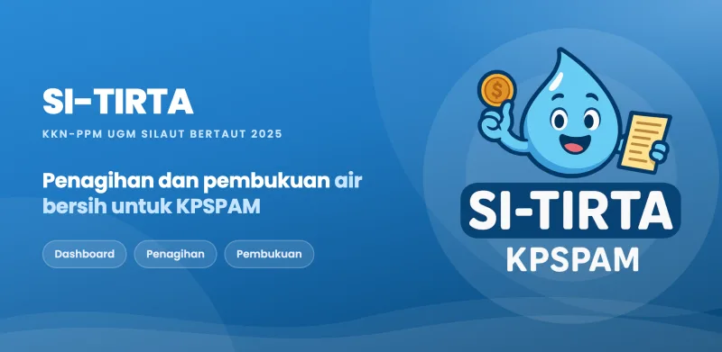</td>
    <td valign="top"><b>SI-TIRTA</b> Water billing and bookkeeping app for a village water utility in West Sumatra. Used for the June 2025 payments and taught to 10 utility officers. <code>Kotlin</code> <code>Firebase</code> <a href="https://github.com/khrlanamm/SI-TIRTA">Repository</a></td>
  </tr>
  <tr>
    <td width="34%"><a href="https://github.com/ReihanZakya/KaizenSpeaking">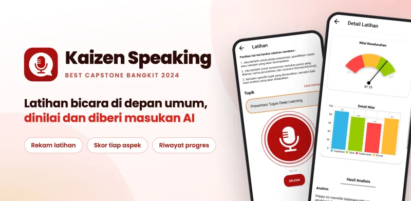</a></td>
    <td valign="top"><b>Kaizen Speaking</b> AI public speaking coach. Best Capstone Project at Bangkit Academy 2024 in the Kaizen Room company track. I built the Android app with two other mobile developers. <code>Kotlin</code> <code>Android</code> <code>Machine learning</code> <a href="https://github.com/ReihanZakya/KaizenSpeaking">Team repository</a></td>
  </tr>
  <tr>
    <td width="34%"><a href="https://kuartetlestari.web.app">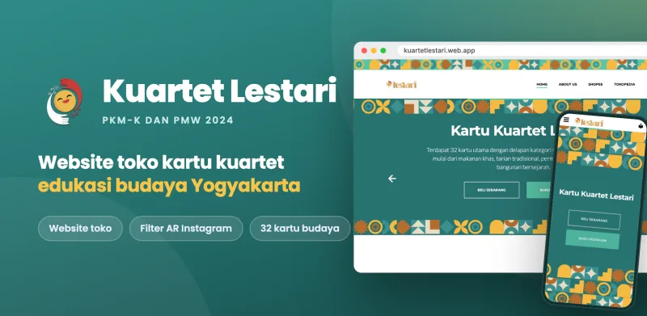</a></td>
    <td valign="top"><b>Kuartet Lestari</b> Educational card game about Yogyakarta culture, run as a student business that won an Inovokasia Award in 2024. I co-founded the business and built the website. <code>HTML</code> <code>CSS</code> <code>JavaScript</code> <code>Firebase</code> <a href="https://kuartetlestari.web.app">Website</a></td>
  </tr>
  <tr>
    <td width="34%"><a href="https://gigi-kecil-6d9e6.web.app">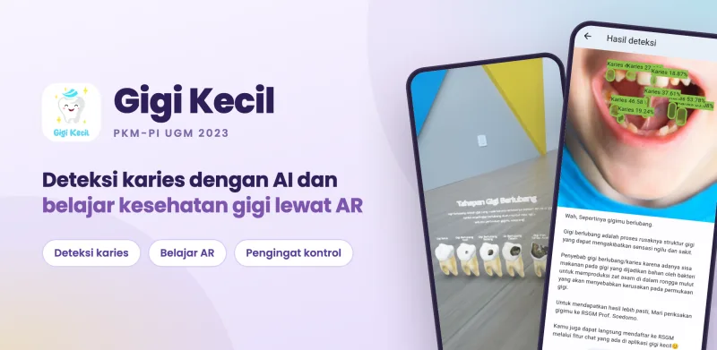</a></td>
    <td valign="top"><b>Gigi Kecil</b> Dental health education app for children with AI caries detection (93% accuracy) and AR lessons. Funded by PKM-PI 2023, with a registered copyright. <code>Flutter</code> <code>React</code> <code>Firebase</code> <a href="https://gigi-kecil-6d9e6.web.app">Website</a></td>
  </tr>
  <tr>
    <td width="34%"><a href="https://play.google.com/store/apps/details?id=com.sabu.saku">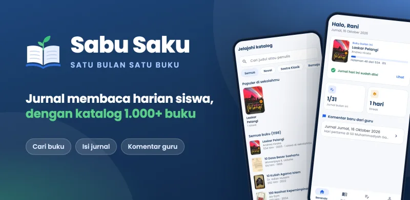</a></td>
    <td valign="top"><b>Sabu Saku</b> Reading journal for high school students built around one book a month, with a catalog of more than 1,000 books and teacher comments. <code>Flutter</code> <code>Firebase</code> <a href="https://play.google.com/store/apps/details?id=com.sabu.saku">Google Play</a> | <a href="https://github.com/khrlanamm/sabusaku">Repository</a></td>
  </tr>
  <tr>
    <td width="34%"><a href="https://play.google.com/store/apps/details?id=com.benevology.warmad">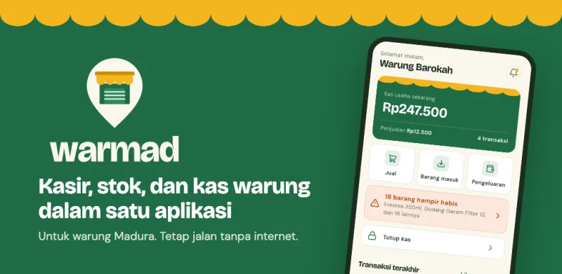</a></td>
    <td valign="top"><b>Warmad</b> Point of sale app for small Madurese neighborhood shops: cashier, stock, customer credit, and daily cash closing, all working offline. <code>Flutter</code> <code>Firebase</code> <a href="https://play.google.com/store/apps/details?id=com.benevology.warmad">Google Play</a> | <a href="https://github.com/khrlanamm/warmad">Repository</a></td>
  </tr>
</table>

## Experience

| Role | Organization | Period |
|---|---|---|
| Software Developer | PT Petrokimia Gresik, IT Department | Aug 2026 - present |
| Information Technology Intern | PT Petrokimia Gresik, Magenta internship | Aug 2025 - Jul 2026 |
| AI Engineer Cohort | Pijak in collaboration with IBM SkillsBuild | Feb 2026 - Jul 2026 |
| Digital Product Developer | Kaizen Room | Feb 2025 - Jun 2025 |
| Mobile Development Cohort | Bangkit Academy by Google, GoTo, and Traveloka | Sep 2024 - Jan 2025 |
| Teaching and Laboratory Assistant | Faculty of Mathematics and Natural Sciences, UGM | Aug 2023 - Dec 2024 |

**Highlights**

- Best Capstone Project, Bangkit Academy 2024, Kaizen Room company track
- Top 50, Student Category, BudayaGO! 2025, Ministry of Culture of the Republic of Indonesia
- Registered copyright for the Gigi Kecil app, 2024
- Student Creativity Program grants, PKM-PI 2023 and PKM-K 2024
- Inovokasia Award 2024 for Kuartet Lestari, Vocational College, UGM

**Open source**

- [Buku Indonesia](https://github.com/khrlanamm/buku-indonesia), open data for Indonesian books: a static JSON API with CSV, JSON, and SQLite downloads
- [SuperTux](https://github.com/SuperTux/supertux), the 2D platformer: [allow binding the console key to other controls](https://github.com/SuperTux/supertux/pull/3910), merged October 2026

## GitHub activity

  <picture>
    <source media="(prefers-color-scheme: dark)" srcset="https://raw.githubusercontent.com/khrlanamm/khrlanamm/output/activity-dark.svg">
    
  </picture>
  <picture>
    <source media="(prefers-color-scheme: dark)" srcset="https://raw.githubusercontent.com/khrlanamm/khrlanamm/output/languages-dark.svg">
    
  </picture>

<picture>
  <source media="(prefers-color-scheme: dark)" srcset="https://raw.githubusercontent.com/khrlanamm/khrlanamm/output/snake-dark.svg">
  
</picture>

Most of my work lives in private and company repositories, so the cards count private contributions and code too. Cards are rebuilt daily by <a href=".github/workflows/stats.yml">a workflow in this repository</a>.

## Writing

<!-- BLOG-POST-LIST:START -->
- [From a Campus Trash Bin to a Bachelor’s Degree](https://medium.com/@khoirulanam1604/from-a-campus-trash-bin-to-a-bachelors-degree-d77dc0e96413) Oct 2026
- [Kaizen Speaking: Empowering Confident Communication Through Technology](https://medium.com/@khoirulanam1604/kaizen-speaking-empowering-confident-communication-through-technology-9bac50ceb79c) Jan 2025
- [Building Dreams, One App at a Time: My Development Journey at Bangkit Academy 2024](https://medium.com/@khoirulanam1604/building-dreams-one-app-at-a-time-my-development-journey-at-bangkit-academy-2024-f0dbd51a2734) Jan 2025
<!-- BLOG-POST-LIST:END -->
